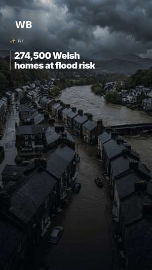
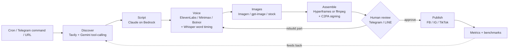

# reel-pipeline

[](https://github.com/arpkan/reel-pipeline/actions/workflows/test.yml)

An automated short-form video pipeline that turns the day's news into narrated, captioned vertical reels, routes each one through human review in Telegram, and publishes to Facebook, Instagram and TikTok on a schedule.

It runs in production for three news brands in three languages (Thai, English, German). The brands in this repo are fictional stand-ins: ThaiDaily, WorldBrief and TagesBrief.

> **About this repo:** a public mirror of a private production repo (363 commits since April 2026). History is squashed for the public release, and brand names and infrastructure details are replaced with placeholders. The dated design docs in [`docs/`](docs/) show how it was built.

<p align="center">
  
</p>

## How it works



| Stage | What happens |
|---|---|
| **Discover** | Searches news (Tavily) and lets Gemini pick a story through a function-calling loop, deduplicating against recent reels. It can also start from a URL pasted into Telegram. URL classification and discovery can be switched to Azure GPT-5.5. |
| **Script** | Claude Sonnet 5.5 (AWS Bedrock) writes a category-specific script (breaking, trending, business, human interest) in the brand's language, with scene-by-scene image prompts. |
| **Voice** | Multi-provider TTS behind one interface. Local Whisper produces word-level timings so captions highlight the word being spoken. |
| **Images** | Generates one image per scene (Gemini Imagen or Azure gpt-image), with an optional free stock-photo layer (Unsplash / Pexels / Pixabay). |
| **Assemble** | Renders a 1080×1920 reel with camera presets (Ken Burns), headline overlays, synced captions, background music and an AI-content badge. Uses an HTML-based renderer (Hyperframes) or ffmpeg. Output is signed with **C2PA content credentials**. |
| **Review** | Posts a review page to Telegram/LINE. Operators approve, reject, or rebuild just the voice, images or music without re-running the whole pipeline. |
| **Publish** | Facebook Reels, Instagram Reels and TikTok, with the source link posted as the first comment. |
| **Learn** | Collects insights, then benchmarks performance by theme, category, voice, music and posting-time bucket to score each reel. |

**StoryReel** is a second pipeline built on the same services. A user sends personal video clips to a Telegram bot. Gemini watches them and writes a direction (cut points, voice style, music mood), and the pipeline returns a narrated rough cut.

## Engineering highlights

- **Responsible AI guards.** AI images are labelled on screen and carry C2PA provenance. An image-prompt guard rewrites scenes that would depict real political figures into anonymous ones.
- **Rendering offload.** Rendering is memory-heavy, so stage 5 can be queued to **SQS**. An on-demand **EC2** worker renders, uploads and terminates itself. Locally, a single-slot assembly lock keeps one render at a time.
- **Crash-safe runs.** Every stage persists its context to SQLite. Runs can resume, re-script, or rebuild a single part, and per-stage timeouts stop runaway jobs.
- **Provider abstraction.** LLM, TTS and image providers are swappable per brand or by env var.
- **Multi-brand, multi-language.** Each brand config sets language, timezone, posting slots, trusted sources, voices and render template.
- **Tests.** 600+ Vitest tests, with HTTP mocked through `nock`, run in GitHub Actions on every push.
- **Design-doc workflow.** Every change starts as a design doc in [`docs/`](docs/) before any code is written.

## Tech stack

TypeScript (Node 22) · Hono · SQLite + Drizzle ORM · node-cron · Vitest

AWS Bedrock (Claude) · Google Gemini / Imagen · Azure OpenAI · Tavily · ElevenLabs · Minimax · Botnoi · Whisper · Hyperframes · ffmpeg · C2PA · Google Cloud Storage · AWS SQS + EC2 · Telegram Bot API · LINE Messaging API · Meta Graph API · TikTok API

## Project layout

```
bin/            server.ts (HTTP + cron + listeners), run.ts (CLI), worker.ts (EC2 render worker)
api/routes/     review, approval, dashboard and webhook routes
src/pipeline/   ReelRunner, StoryRunner, Telegram/LINE command listener
src/stages/     discover, script, voice, images, assemble (+ renderers/templates)
src/services/   provider clients: LLMs, TTS, images, storage, queues, social APIs, metrics
src/brands/     per-brand configuration
src/db/         SQLite schema and queries
docs/           design docs and implementation plans, one per change
tests/          Vitest suite
```

## Running locally

Requirements: Node 22+, ffmpeg, and API keys for the providers you enable.

```bash
npm install
cp .env.example .env      # fill in the keys you need
npm test                  # external APIs are mocked
npm run dev               # server on :3100 with cron + Telegram listeners
npx tsx bin/run.ts ns --reel --dry-run    # one reel from the CLI
```

StoryReel's background music isn't committed. See [`music/storyreel/README.md`](music/storyreel/README.md).

See [CONTRIBUTING.md](CONTRIBUTING.md) for conventions and the design-doc workflow.

## Author

**arpkan**: [GitHub](https://github.com/arpkan)

I designed and run this pipeline. It has published reels daily since April 2026, now for three news brands. I wrote the design doc for every change in [`docs/`](docs/) and made the architecture, provider and responsible-AI decisions (C2PA signing, on-screen AI labels, the political-figure guard). Every reel goes through my review before it is published.

The code was written with AI coding agents working from those design docs: Claude Code (Claude), OpenCode (GPT, GLM) and Antigravity (Gemini). I reviewed and tested each change before deploying it.

## License

[MIT](LICENSE)
